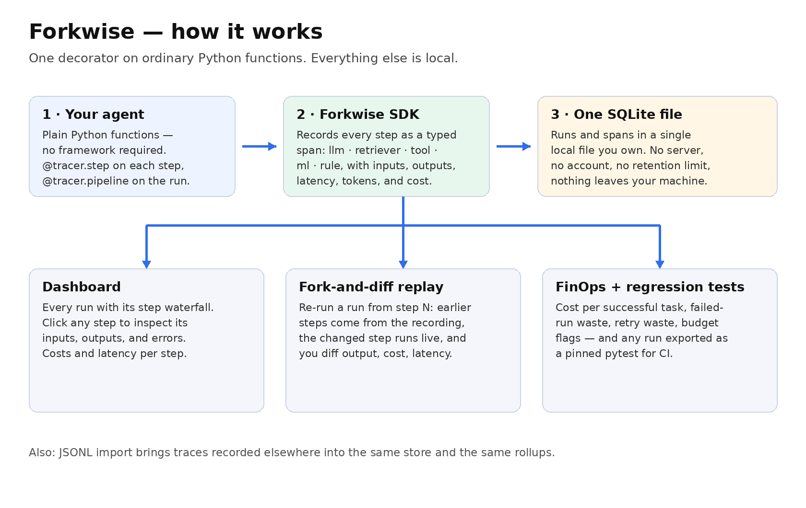
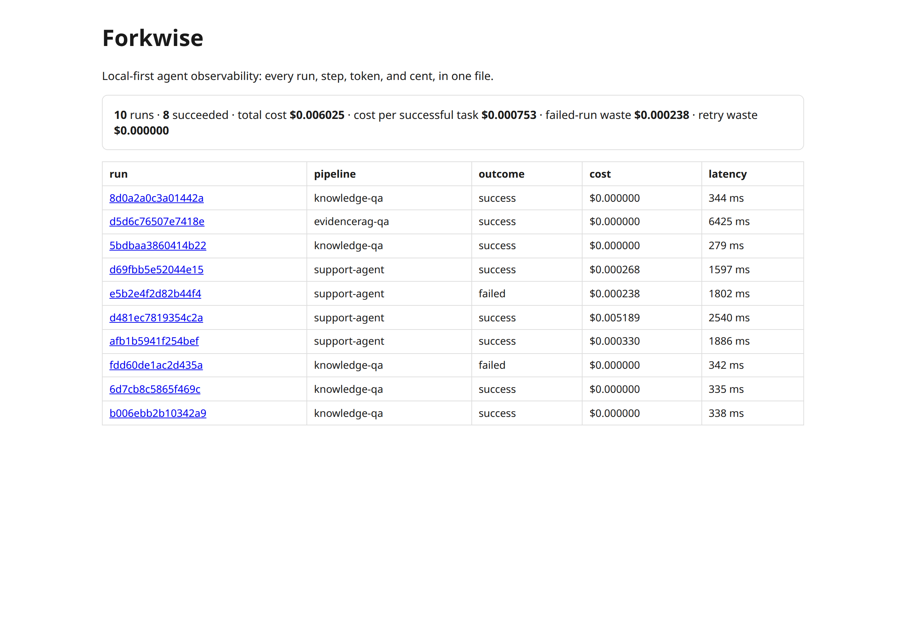
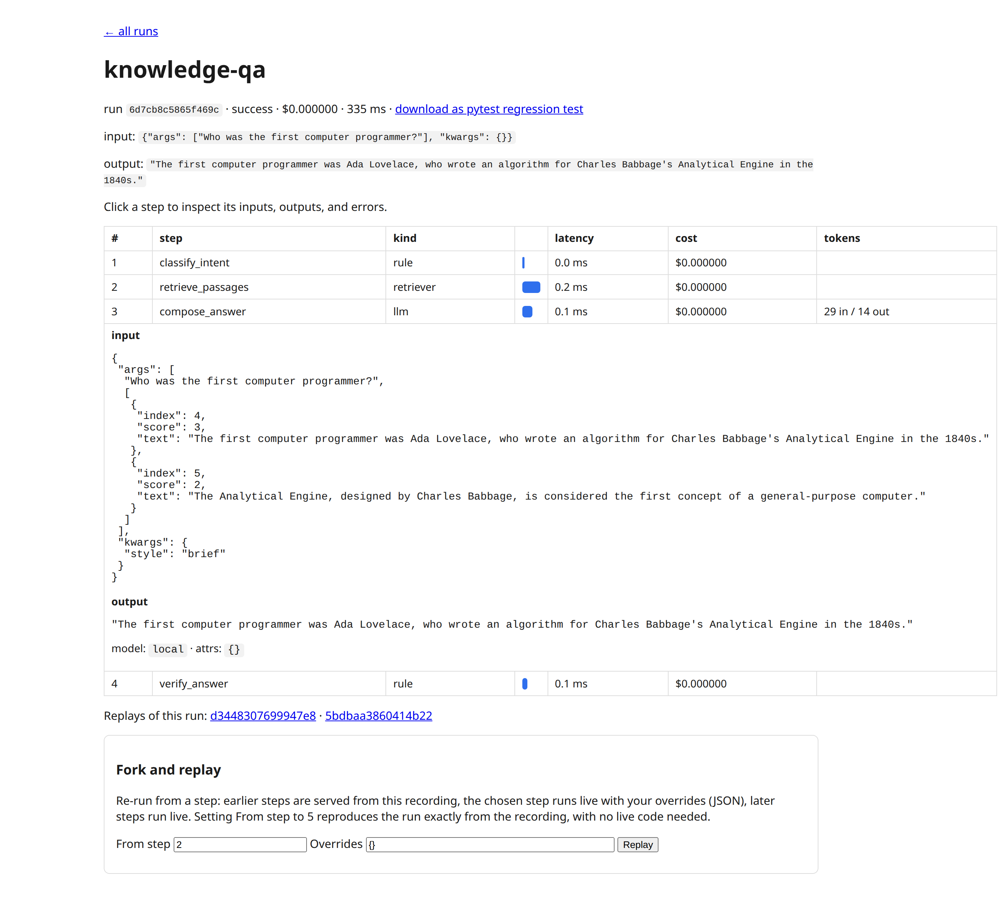
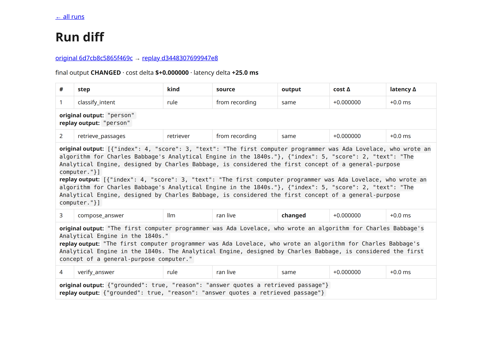

# Forkwise

**Local-first observability, fork-and-diff replay, and cost analytics for plain-Python AI agents.**

Forkwise answers three questions about any agent you run: *what did it do, what did it cost, and what happens if I change this one step?* It is one `pip install`, one decorator, and one SQLite file. No account, no servers to run, no retention limit, no framework required.

> The obvious name in this space belongs to an existing company; this project is unaffiliated.



## See it

The dashboard — every run, its outcome, cost, and latency, with FinOps totals on top:



A single run, with one step's inspector open (these are the recorded inputs a fork can override):



Fork-and-diff: the same run re-executed from step 3 with the answer style overridden — steps 1–2 served from the recording, the changed step and everything after it live, final output CHANGED:



## Why this exists

The incumbents are good tools with the wrong shape for small teams:

- **Free tiers ration the wrong things.** LangSmith's free plan is 1 seat, 5,000 traces/month, 14-day retention. Most tools meter per span, so one 20-step agent run burns twenty units. Langfuse's free tier allows two alerts.
- **Self-hosting is heavy or gated.** Langfuse self-hosting runs six containers (Postgres, ClickHouse, Redis, MinIO, web, worker). LangSmith, Braintrust, and PromptLayer gate self-hosting behind Enterprise contracts.
- **They assume a framework.** Auto-instrumentation targets LangChain, CrewAI, and friends. A hand-rolled Python agent gets manual span plumbing or nothing — and steps that are not LLM calls (retrieval, tools, rules, classical ML) are second-class, untyped and unpriced.
- **Nobody rolls cost up to the task.** Spans have token counts; nobody tells you the cost *per successful task*, what failed runs wasted, or what retry loops burned. Budget enforcement exists only in gateway products, scored "never" for the major observability tools.
- **Replay means re-watching, not re-running.** Phoenix can replay a single LLM call with a tweaked prompt. Nothing re-executes a run *from the step you changed*, with the other steps served from the recording, and diffs the outcome.

Forkwise is built directly into those five gaps. Full market analysis: the "Agent Observability Competitive Landscape" study (14 products, sources cited).

## The five features

1. **Fork-and-diff replay.** Re-execute a recorded run from step N: earlier steps are served from the recording (tools and retrievers are not called again), step N runs live with your overrides (a different model, different parameters), later steps run live. You get a step-by-step diff: output changes, cost delta, latency delta.
2. **Local-first.** One decorator on ordinary functions; everything lands in a single SQLite file you own. Unlimited retention because it is your disk.
3. **Agent FinOps.** Cost per successful task, failed-run waste, retry waste (the same step re-invoked with identical input), latency percentiles, and budget flags for runs over your cost or latency ceilings.
4. **Typed plain-Python steps.** `llm`, `retriever`, `tool`, `ml`, `rule` — every kind is a first-class, costed span, no framework and no OpenTelemetry boilerplate.
5. **Trace -> pytest.** One click turns a recorded run into a pinned, deterministic regression test that replays from the recording and asserts the output. It runs in CI with no vendor account and no network.

## Quickstart

```bash
pip install -r requirements.txt
python demo/seed.py                 # demo agent runs + imported sample traces
uvicorn forkwise.server:app --port 8000
```

Then open http://localhost:8000 for the dashboard.

```python
from forkwise import Tracer, report_usage

tracer = Tracer("runs.db")

@tracer.step(kind="retriever")
def retrieve(question, top_k=2): ...

@tracer.step(kind="llm")
def compose(question, docs, model="gpt-4o-mini"):
    ...
    report_usage(model=model, tokens_in=812, tokens_out=140)
    return answer

@tracer.pipeline("qa-agent")
def qa(question):
    return compose(question, retrieve(question))
```

Replay a run from the dashboard, or in code:

```python
from forkwise.replay import replay_run
new_run, diff = replay_run(tracer, run_id, from_seq=2,
                           overrides={"model": "gpt-4o"})
print(diff["total_cost_delta"], diff["output_changed"])
```

Import traces you already have (JSONL, one run per line) and get the FinOps rollups without re-instrumenting:

```bash
curl -X POST localhost:8000/api/import --data-binary @demo/sample_traces.jsonl
```

## First instrumented app: EvidenceRAG

`demo/evidencerag_bridge.py` traces real queries from EvidenceRAG (the companion portfolio project: hybrid retrieval -> cross-encoder rerank -> extractive answer) into the same database, so both projects' runs sit side by side in one dashboard.

## Design decisions worth asking about

- **Why SQLite?** The unit of adoption for a small team is one file. Concurrency needs here are modest; the store is deliberately boring, and the schema is two tables a new hire can read in a minute.
- **Why serve earlier steps from the recording during replay?** Because re-calling tools and retrievers makes replay slow, expensive, and non-deterministic. Feeding recorded outputs forward isolates exactly the step you changed — that is what makes the diff mean something.
- **Why is success a first-class field?** Because cost per *successful* task is the number a business runs on, and you cannot compute it from spans alone unless the run records whether the task actually worked.
- **Honest limits.** Replay needs the pipeline's module importable and step outputs JSON-serializable to be served from a recording. Costs are computed from token counts you report, priced from an editable table — unknown models are flagged unpriced rather than silently zeroed. The demo's compose step runs a local model at $0; priced examples come from the imported sample traces, which are labeled as imports.

## Tests

```bash
python -m pytest tests/ -q   # 8 tests: tracing, cost math, fork semantics,
                             # full-replay reproduction, failure waste,
                             # import + retry waste, exported-test validity,
                             # budget flags
```

## License

MIT.
